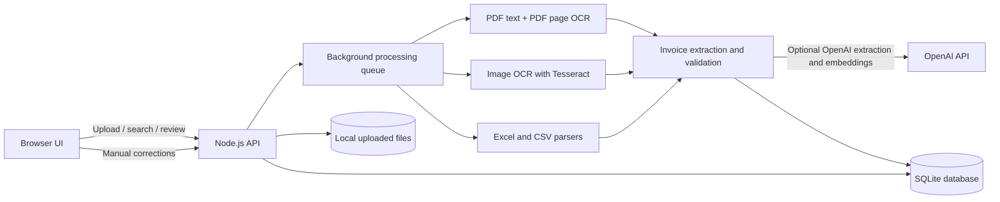

# Architecture



## Data model

The local SQLite database stores one row per document with metadata, processing state, extracted text, structured field JSON, validation errors, review reason, processing history, and optional semantic-search embedding. The original file is kept in `uploads/` under a generated ID. Upload filenames are stored as metadata and are not used as disk paths.

## Processing flow

Uploads are persisted before work is queued. Digital PDFs use embedded text; scanned or low-text pages are rendered and passed to Tesseract, including scanned pages mixed with digital pages. PDF text items are grouped by page coordinates to preserve table columns. Images use Tesseract directly. Spreadsheets read every sheet and CSV files retain row structure. A classifier separates invoice, non-invoice, and uncertain files. Invoice fields are extracted with conservative patterns or, when `OPENAI_API_KEY` is configured, an LLM call that is instructed to return null for unknown values. Validation checks required fields, numeric consistency, line-item totals, and duplicate invoice identifiers. The review UI lets a human correct fields and re-run validation. Users can select 2-10 completed invoices for cross-verification; the comparison reports matches, missing values, header conflicts, and line-item subtotal conflicts across PDFs, images, and spreadsheets.

The queue runs one job at a time in the API process to limit local OCR memory use. Queued or interrupted jobs are recovered from SQLite when the API restarts. This is not a multi-process or distributed queue.

## SQLite schema

The current schema uses one row per document. `sql.js` persists the in-memory SQLite database to `data/ledgerlens.sqlite`; JSON columns hold variable-size values.

```sql
CREATE TABLE documents (
  id TEXT PRIMARY KEY,
  name TEXT NOT NULL,
  extension TEXT NOT NULL,
  size INTEGER NOT NULL,
  status TEXT NOT NULL,
  document_type TEXT,
  uploaded_at TEXT NOT NULL,
  updated_at TEXT NOT NULL,
  stored_name TEXT NOT NULL,
  extracted_text TEXT DEFAULT '',
  fields_json TEXT DEFAULT '{}',
  validation_json TEXT DEFAULT '[]',
  review_reason TEXT,
  error TEXT,
  history_json TEXT DEFAULT '[]',
  embedding_json TEXT,
  pages INTEGER DEFAULT 1,
  progress INTEGER DEFAULT 0
);
CREATE INDEX idx_documents_status ON documents(status);
CREATE INDEX idx_documents_uploaded ON documents(uploaded_at);
```

`fields_json` stores invoice headers and line items; `validation_json` stores structured issue codes and messages; `history_json` stores timestamped processing and correction events. Semantic embeddings are optional and only saved when configured.

## Local limitations

The local app has Admin and Employee roles stored in SQLite. The first account is the Admin and sets a PIN; later Employee accounts are created by an Admin. Admins can access all documents, while Employees can access documents associated with their account. The API applies this scope to lists, searches, comparisons, detail records, edits, reprocessing, and original-file downloads. Password reset, encrypted at-rest files, cloud storage, and a distributed queue are not included. Semantic search uses embeddings only when the API key is configured; otherwise it falls back to keyword matching. Do not expose this local server to the public internet.


## Local account storage

The same SQLite file also stores the single local owner account and login sessions. Passwords use a unique salt and Node.js scrypt hash; session cookies contain random tokens, while the database stores only their SHA-256 hashes and expiry timestamps. Google accounts are linked by their verified provider subject and email after the server validates the ID token. Document, search, upload, and review API routes require a valid session.

```sql
CREATE TABLE users (
  id TEXT PRIMARY KEY,
  email TEXT NOT NULL UNIQUE,
  name TEXT NOT NULL,
  password_salt TEXT,
  password_hash TEXT,
  google_sub TEXT UNIQUE,
  created_at TEXT NOT NULL
);
CREATE TABLE sessions (
  token_hash TEXT PRIMARY KEY,
  user_id TEXT NOT NULL,
  created_at TEXT NOT NULL,
  expires_at TEXT NOT NULL,
  FOREIGN KEY(user_id) REFERENCES users(id) ON DELETE CASCADE
);
```
